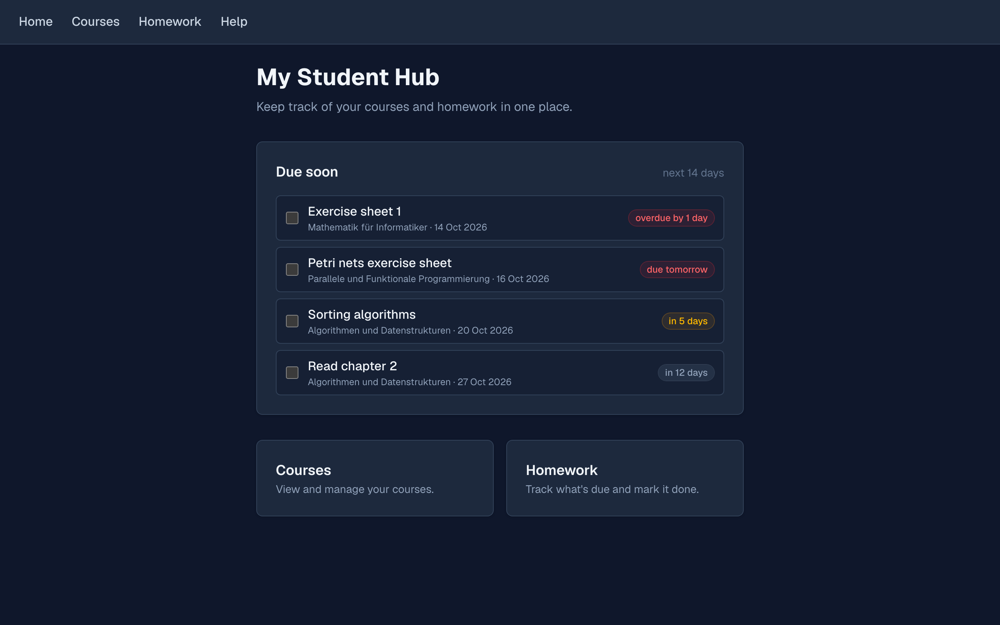
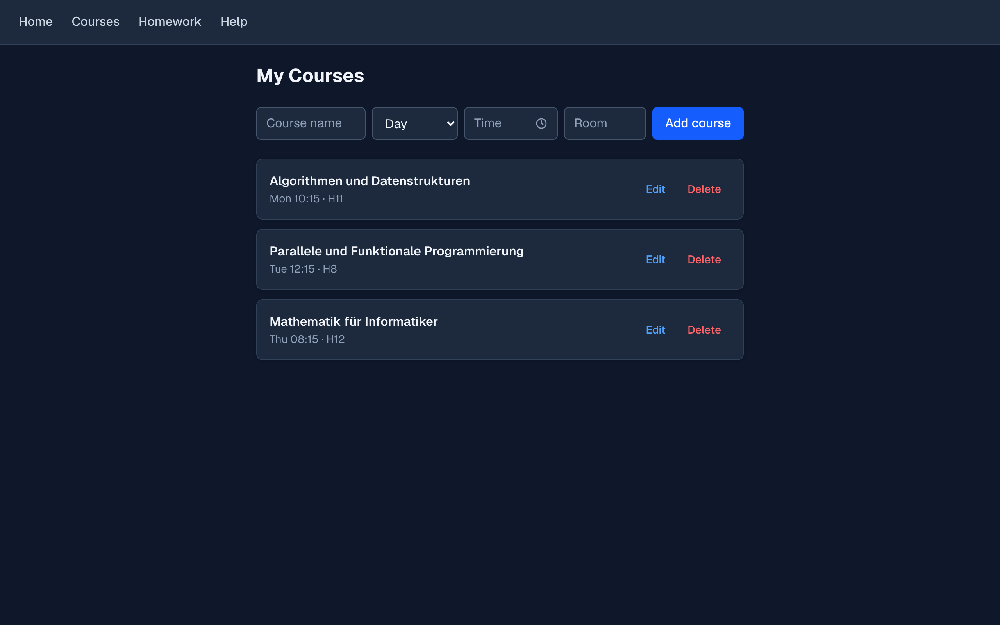

# Student Hub

A small web app for keeping track of university courses and homework, built with Next.js and TypeScript.

**Live:** https://student-hub-chi-khaki.vercel.app

I built it because every planner I tried was either overkill or wanted an account before it would show me anything. This one opens straight into your homework.

<!--
Screenshots go here. Take one of the home page and one of the courses page,
save them as docs/home.png and docs/courses.png, then uncomment:



-->

## What it does

- **Courses** — name, weekly slot (day + time), and room, all editable in place.
- **Homework** — title, description, linked course, and due date. Tick items off as you finish them.
- **Due soon** — the home page lists anything overdue or due within the next 14 days, most urgent first, colour-coded: red for overdue or due today/tomorrow, amber for the rest of the week, grey beyond that.
- **Help** — a placeholder support page while the real one doesn't exist yet, complete with a chatbot that is honest about being forty if-statements in a trench coat.

Everything is stored in the browser, so there is no sign-up and no server.

## Running it locally

```bash
npm install
npm run dev
```

Then open http://localhost:3000.

```bash
npm run build   # production build + type check
npx eslint app  # lint
```

## Built with

- **Next.js 16** (App Router) and **React 19**
- **TypeScript**
- **Tailwind CSS v4**
- **localStorage** for persistence
- Deployed on **Vercel**

## Things I learned building it

The parts that turned out to be more interesting than expected:

**Native browser widgets can't be styled.** `<input type="date">` and `window.confirm()` are drawn by the browser and the operating system, so no amount of CSS reaches them — they broke the dark theme completely. Both are now custom components (`DatePicker`, `TimePicker`, `ConfirmDialog`). Scrollbars turned out to be the opposite case: they *are* styleable, and `color-scheme: dark` on `:root` fixes the rest of the native UI in one line.

**Dates and timezones.** Building a date string with `toISOString()` converts to UTC first, which shifts the day for anyone not on Greenwich time. The pickers build `YYYY-MM-DD` by hand from `getFullYear`/`getMonth`/`getDate` instead. Similarly, "is this due today" has to compare dates floored to midnight, or something due at 23:00 tonight reads as *in 0 days* one minute and *overdue* the next.

**Two tabs can silently overwrite each other.** Each page originally kept its own copy of the data in React state, so a change in one tab was invisible to the other — and the stale tab would happily save over it. Storage now lives in one module (`app/lib/store.ts`) built on `useSyncExternalStore`. Two things there were not obvious:

- The hook compares snapshots by identity, so returning a fresh array from `JSON.parse` on every read causes an infinite render loop. The parse is cached and reused until the underlying JSON string actually changes.
- The `storage` event only fires in *other* tabs, so local writes have to notify subscribers themselves.

**Changing a data shape means thinking about old data.** When course times became a day + time picker instead of free text, courses saved under the old format still had to display and still had to survive being edited. Editing preserves IDs for the same reason — homework links to courses by ID, so regenerating one would orphan every homework attached to it.

## Known limitations

- Data lives in `localStorage`, so it is per-device and per-browser. Your phone and your laptop hold separate data, and clearing browser data wipes it.
- There is no export or backup yet.
- A course can only have one weekly slot, so a course meeting twice a week has to be added twice.
- The pickers are mouse-driven; no arrow-key navigation yet.

## Ideas for later

- Export and import your data as a file
- Sorting and filtering on the homework page
- Multiple time slots per course
- Accounts and a real database, so data follows you between devices
